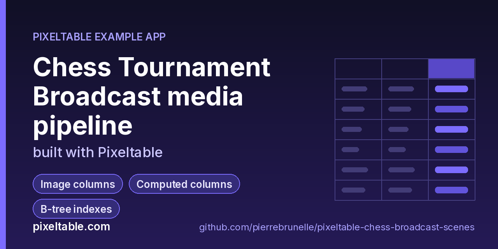

<!-- pixeltable-example-app: 20261028-chess-broadcast-scenes -->
# Chess Tournament Broadcast media pipeline built with Pixeltable



[](https://codespaces.new/pierrebrunelle/pixeltable-chess-broadcast-scenes?quickstart=1)
[](https://pixeltable.com)
[](https://pypi.org/project/pixeltable/)
[](https://github.com/pixeltable/pixeltable)
[](LICENSE)

`Games` holds one board's broadcast recording per round (`game_id` primary key, players, result, `video`). Computed columns read container and stream metadata (`video.get_metadata`, `get_duration`), detect scenes twice (`scene_detect_content` and `scene_detect_histogram`), count them, check that the scenes cover the whole recording and turn them into a cut list. Three component views run on every insert: `Frames` samples 5 frames per second with `frame_iterator` and classifies each frame as board cam, player cam, clock graphic or result card, then reads the board back into an occupancy string (`board_fen`); `Keyframes` keeps only the encoder keyframes; `Clips` splits every recording into 4-second highlight clips with `video_splitter`, keeping the shorter last clip. `@pxt.query` functions return a game's scenes, its final position (the last board-cam frame) and a round summary. `make_videos.py` renders small deterministic broadcasts with a known shot list, so `pipeline.py verify` can prove that the last scene (a 1-second result card) and the last frame survive scene detection and frame extraction.

[Pixeltable](https://pixeltable.com) is open-source, Python-native **multimodal AI data infrastructure**: tables, incremental computed columns, UDFs, indexes and serving in one library, running locally or on Pixeltable Cloud.

> ⭐ **Like this example?** Star [pixeltable/pixeltable](https://github.com/pixeltable/pixeltable) on GitHub. It helps other developers find it.

## What this example shows

- **Incremental computed columns** powered by plain Python UDFs (`@pxt.udf`)
- **B-tree indexes** declared on the model (`__indexes__`) back the lookup queries
- **Multimodal media columns** with configurable media destinations
- **Iterators**: one input row fans out into many (frames, chunks, sentences) via a view
- **Importable UDF module**: UDFs live in `udfs.py`; tables and queries live in `app.py` (Pixeltable resolves UDFs by module path)
- **`pixeltable.toml`** declares a local database and a **Pixeltable Cloud** database, so the same code deploys with `pxt db update`

## Video building blocks used here

| Need | Pixeltable |
|---|---|
| Container + stream metadata (typed JSON) | `pxtf.video.get_metadata(video)`, `get_duration(video)` |
| Scene boundaries | `pxtf.video.scene_detect_content(video, threshold=27.0, min_scene_len=10)` (also `_histogram`, `_adaptive`, `_hash`, `_threshold`) |
| Sampled frames as rows | view with `iterator=pxtf.video.frame_iterator(Games.video, fps=5.0)` |
| Keyframes only | `frame_iterator(Games.video, keyframes_only=True)` |
| Fixed-length clips | `video_splitter(Games.video, duration=4.0, min_segment_duration=0.5)` |
| Image metadata per frame | `pxtf.image.get_metadata(frame)` |

## Notes

- Scene detection and frame extraction keep the final scene and the final frame of a recording (pixeltable 0.7.21 and later), so a short closing shot such as a result card is not lost. `pipeline.py verify` checks exactly that against the rendered shot list.
- After upgrading pixeltable, `recompute_columns()` refreshes stored scene lists, while rows that iterator views produced before the upgrade stay as they were; re-insert those recordings to regenerate their frames.
- Sort by a regular column (`Frames.t`, a Float computed column) rather than by a JSON path such as `frame_attrs['time']`.

## What's inside

| File | What it is |
|------|------------|
| `.devcontainer/devcontainer.json` | GitHub Codespaces / Dev Container config: Python 3.12, installs `requirements.txt` |
| `.github/social-preview.png` | Social preview image (1280x640) |
| `CITATION.cff` | Citation metadata (authors, license, release date, keywords) |
| `app.py` | Tables declared as Python classes and `@pxt.query` functions |
| `data/r1-b1.mp4` | Sample data |
| `data/r1-b2.mp4` | Sample data |
| `data/r2-b1.mp4` | Sample data |
| `data/r2-b2.mp4` | Sample data |
| `data/truth.json` | Sample data |
| `make_videos.py` | Render small, deterministic chess-broadcast videos into data/ (no downloads needed) |
| `pipeline.py` | Chess broadcast pipeline driver (no server) |
| `pixeltable.toml` | Project config: the local database plus a Pixeltable Cloud database (sizing, deploy excludes) |
| `udfs.py` | Pixeltable UDFs (`@pxt.udf`) in their own importable module, imported by `app.py` |
| `requirements.txt` / `pyproject.toml` | Dependencies (`pixeltable>=0.7.21`) |

**Tables**

| Table | Stored columns | Computed columns |
|-------|---------|------------------|
| `games` | `game_id`, `round_no`, `white`, `black`, `result`, `video` | `meta`, `duration`, `stream_frames`, `fps`, `scenes`, `scenes_hist`, `n_scenes`, `n_scenes_hist`, `coverage`, `cuts` |
| `frames` | - | `t`, `kind`, `fen`, `pieces`, `img_meta` |
| `keyframes` | - | `t`, `kind` |
| `clips` | - | `clip_seconds` |

## Run in your browser (GitHub Codespaces)

[](https://codespaces.new/pierrebrunelle/pixeltable-chess-broadcast-scenes?quickstart=1)

1. Click **Open in GitHub Codespaces** above (or [this link](https://codespaces.new/pierrebrunelle/pixeltable-chess-broadcast-scenes?quickstart=1)). The dev container installs Python 3.12 and `pixeltable>=0.7.21` from `requirements.txt`.
2. In the codespace terminal, create the tables, seed them and run the app:

   ```bash
   pxt schema update app.py chess
   python make_videos.py                    # render data/*.mp4 (4 games, 25 fps) + data/truth.json with the exact shot list
   python pipeline.py ingest                # insert the recordings: scenes, frames, keyframes and clips compute on insert
   python pipeline.py report                # per-round scenes and cut lists, final board of every game
   python pipeline.py verify                # last scene and last frame kept? final board matches the render?
   python pipeline.py export                # sampled frames (time, shot kind, board) -> output/frames.csv
   pxt describe chess/games                 # the computed columns, from the CLI
   pxt count chess/frames
   ```


## Quickstart

Requires Python 3.11+ and `pixeltable>=0.7.21`.

```bash
git clone https://github.com/pierrebrunelle/pixeltable-chess-broadcast-scenes.git
cd pixeltable-chess-broadcast-scenes
python -m venv .venv && source .venv/bin/activate
pip install -r requirements.txt

# Create the tables in a local catalog directory named `chess`
pxt schema update app.py chess

python make_videos.py                    # render data/*.mp4 (4 games, 25 fps) + data/truth.json with the exact shot list
python pipeline.py ingest                # insert the recordings: scenes, frames, keyframes and clips compute on insert
python pipeline.py report                # per-round scenes and cut lists, final board of every game
python pipeline.py verify                # last scene and last frame kept? final board matches the render?
python pipeline.py export                # sampled frames (time, shot kind, board) -> output/frames.csv
pxt describe chess/games                 # the computed columns, from the CLI
pxt count chess/frames
```

## Deploy to Pixeltable Cloud

The same `app.py` runs on [Pixeltable Cloud](https://pixeltable.com). Sign in (or get a free trial database with `pxt new`), point the second database entry in `pixeltable.toml` at your own database, then deploy:

```bash
pxt login                       # or: export PIXELTABLE_API_KEY=<your-api-key>
# edit pixeltable.toml: name = 'pxt://<your-org>:<your-db>'
pxt db update pxt://<your-org>:<your-db>                 # build the image and upload the project
pxt schema update app.py pxt://<your-org>:<your-db>/chess   # create the tables in the hosted database
```

Keep keys in environment variables or `pxt secret set`, never in code.

## Code walkthrough

**1. Business logic is plain Python, in `udfs.py`.** A `@pxt.udf` function can be used as a column expression. Pixeltable records UDFs by module path (`udfs.shot_kind`), so they live in their own importable module rather than inline in the app: the daemon, serving workers and Pixeltable Cloud import it again by that path.

```python
# udfs.py
@pxt.udf
def shot_kind(frame: PIL.Image.Image) -> str:
    """'board' | 'player' | 'clock' | 'result' from the frame's mean colour."""
    r, g, b = _mean(frame)
    if b > r + 40 and b > g + 20:
        return 'player'
    if r + g + b < 120:
        return 'clock'
    if r > 200 and g > 200 and b > 200:
        return 'result'
    return 'board'
```

**2. Tables are Python classes (`app.py`).** Annotated attributes are stored columns; attributes assigned an expression are **computed columns** (`meta`, `duration`, `stream_frames`, `fps`, `scenes`, `scenes_hist`, `n_scenes`, `n_scenes_hist`, `coverage`, `cuts`), evaluated incrementally on every insert or update and recomputed when their inputs change. Indexes live next to the columns.

```python
# app.py
class Games(TableModel, name='games'):
    """One board's broadcast recording for one round."""

    game_id = pxt.Column(type=pxt.String, primary_key=True)
    round_no: pxt.Int
    white: pxt.String
    black: pxt.String
    result: pxt.String
    video: pxt.Video

    meta = pxtf.video.get_metadata(video)
    duration = pxtf.video.get_duration(video)
    stream_frames = meta.streams[0].frames.astype(pxt.Int)
    fps = meta.streams[0].average_rate.astype(pxt.Float)
    scenes = pxtf.video.scene_detect_content(video, threshold=27.0, min_scene_len=10)
    scenes_hist = pxtf.video.scene_detect_histogram(video, min_scene_len=10)
    n_scenes = scene_count(scenes)
    n_scenes_hist = scene_count(scenes_hist)
    coverage = scene_coverage(scenes, duration)
    cuts = scene_cuts(scenes)

    __indexes__ = [pxt.BtreeIndex(round_no)]
```

**3. Queries are functions (`app.py`).** `@pxt.query` wraps a Pixeltable query so it can be called from Python or exposed as a route:

```python
# app.py
@pxt.query
def game_scenes(game_id: str):
    """Detected scenes and the cut list of one game."""
    return Games.where(Games.game_id == game_id).select(
        Games.game_id, Games.n_scenes, Games.scenes, Games.cuts, Games.coverage
    )
```

## Learn more

- 🌐 Website: https://pixeltable.com
- 📚 Docs: https://docs.pixeltable.com
- 💻 Source: https://github.com/pixeltable/pixeltable (⭐ star it if Pixeltable is useful to you)
- 📦 PyPI: https://pypi.org/project/pixeltable/
- 🧩 More example apps: https://pierrebrunelle.github.io/awesome-pixeltable-apps/

**[More Pixeltable example apps →](https://pierrebrunelle.github.io/awesome-pixeltable-apps/)**

---

<sub>Built as part of a daily series of Pixeltable example apps · Pixeltable 0.7.21 · Python, incremental computed columns · Licensed under Apache-2.0.</sub>
